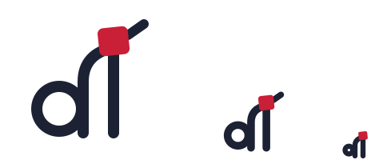
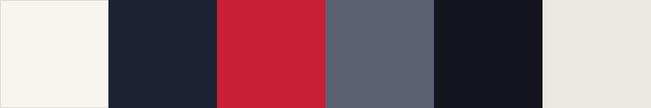

<p align="center">
  <picture>
    <source media="(prefers-color-scheme: dark)" srcset="assets/svg/lockup-dark.svg">
    
  </picture>
</p>

<p align="center"><b>I build AI agents for security, and the tools I need along the way.<br>Everything I learn, I share.</b></p>

<p align="center">
  <a href="docs/brand.md">Guidelines</a> ·
  <a href="tokens/tokens.json">Tokens</a> ·
  <a href="assets/svg">Assets</a> ·
  <a href="https://davideimola.dev">davideimola.dev</a>
</p>

---

This is the brand behind [davideimola.dev](https://davideimola.dev) and my talks: one source of truth for colours, type, the mark and the rules that hold them together. The site and the slides both install it, so a change here reaches everything.

## The mark

<picture>
  <source media="(prefers-color-scheme: dark)" srcset="docs/images/cuts-dark.svg">
  
</picture>

A `d` and an `i` drawn as a git graph. The bowl of the `d` is a commit, its stem is a branch merging into a straight `i`, and the merge is tied with a red knot, the knot of a martial arts belt. A merge for whoever writes code, a knot for whoever knows the mat.

It comes in three cuts of the same drawing, so it never gets lost: **L** from 96 px, **M** from 40 px, **S** down to 16 px.

## The name

<picture>
  <source media="(prefers-color-scheme: dark)" srcset="assets/svg/wordmark-dark.svg">
  
</picture>

Drawn with the mark's own rules: monoline strokes, round bowls, and both `i`s dotted with the red knot.

## Colour and type



| | Light | Dark |
|---|---|---|
| Ground | `#F7F5F0` paper | `#13151C` night |
| Ink | `#1C2233` | `#ECE9E2` chalk |
| Accent | `#C91F37` akane | `#E0475C` |

**Red belongs to the knot and the marker, nothing else.**

Type is [Schibsted Grotesk](https://fonts.google.com/specimen/Schibsted+Grotesk) for everything you read, [IBM Plex Mono](https://fonts.google.com/specimen/IBM+Plex+Mono) for code and metadata, and [Barlow Condensed](https://fonts.google.com/specimen/Barlow+Condensed) for one thing only: the label-maker tape on sections.

The full system (the marker, the tape, the rule, the site and slide layouts) is in [`docs/brand.md`](docs/brand.md).

## Use it

```sh
pnpm add github:davideimola/brand
```

Plain CSS, light and dark themes included:

```css
@import "@davideimola/brand/tokens.css";

body {
  background: var(--di-bg);
  color: var(--di-fg-body);
  font-family: var(--di-font-family-sans);
}
```

Tailwind v4 (`bg-bg`, `text-fg`, `text-accent`, `bg-tape-bg`, `font-label`, and so on):

```css
@import "tailwindcss";
@import "@davideimola/brand/tailwind.css";
```

Scripts can read `@davideimola/brand/tokens.json` or import `@davideimola/brand/tokens`.

## Change it

Edit `tokens/tokens.json` or `src/geometry.mjs`, then:

```sh
pnpm install
pnpm build
```

`dist/`, `assets/` and `docs/images/` are generated and committed, so consumers never build anything. Never edit them by hand.

## License

The mark, the name and the lockups in `assets/` are [CC BY-ND 4.0](LICENSE-ASSETS.md): use them as they are to refer to me, in event pages, programs, articles. Don't redraw or recolour them. Tokens, scripts and docs are [MIT](LICENSE).
